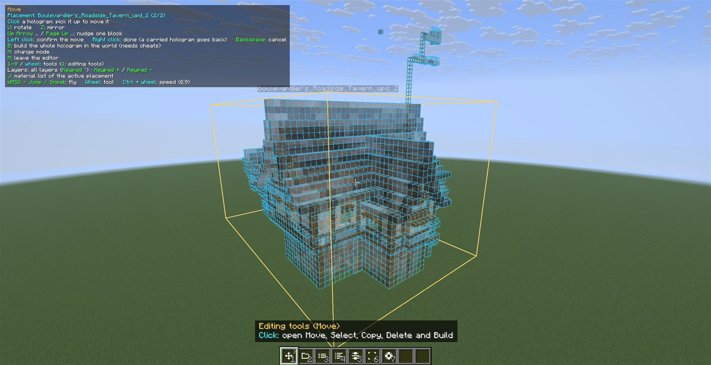
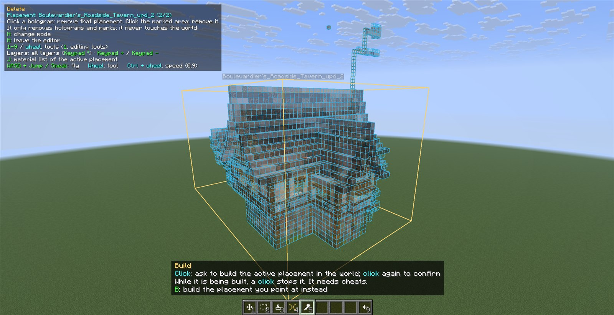
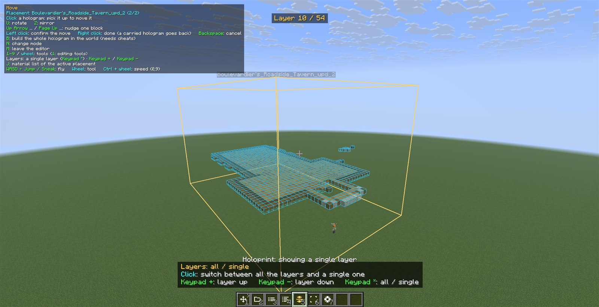
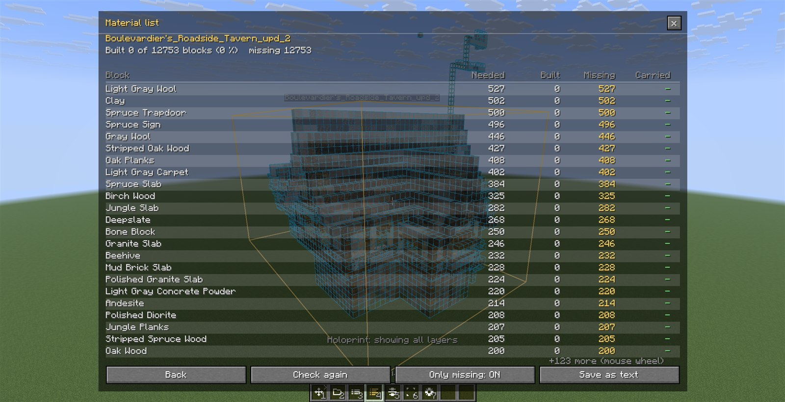
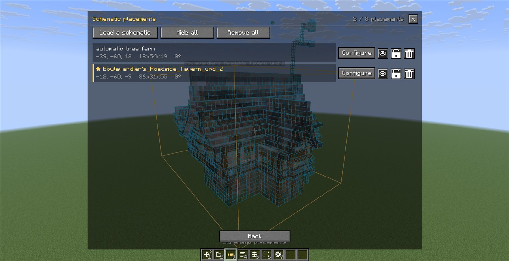
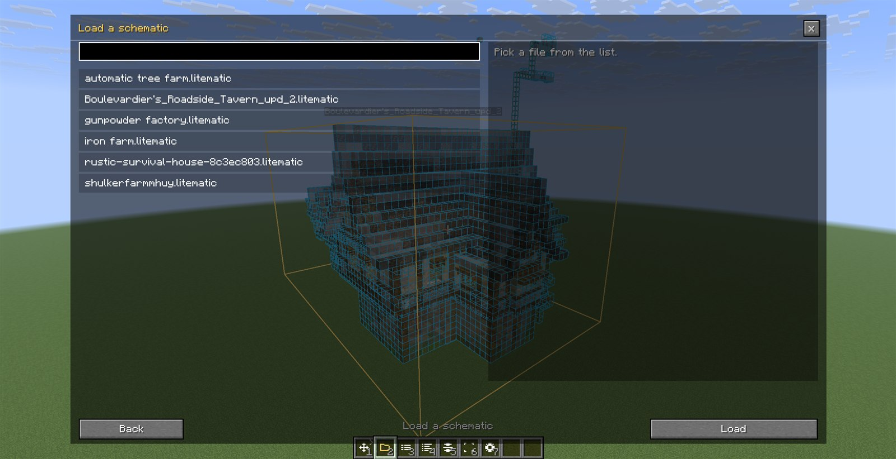
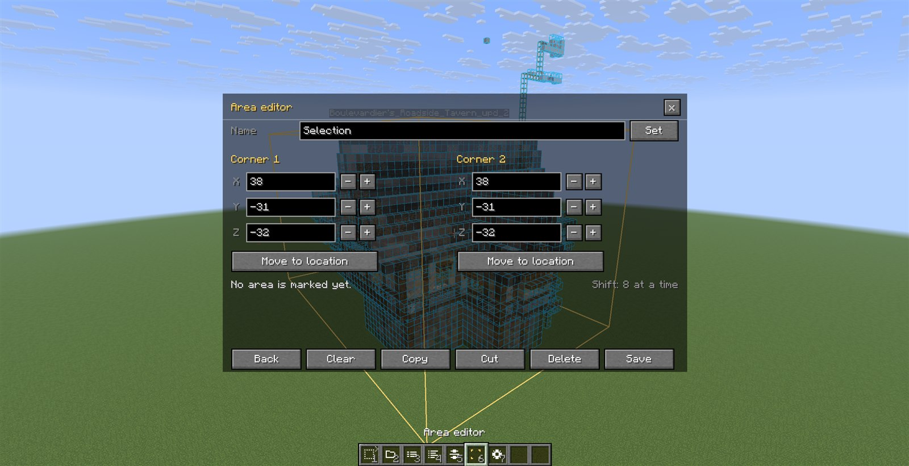
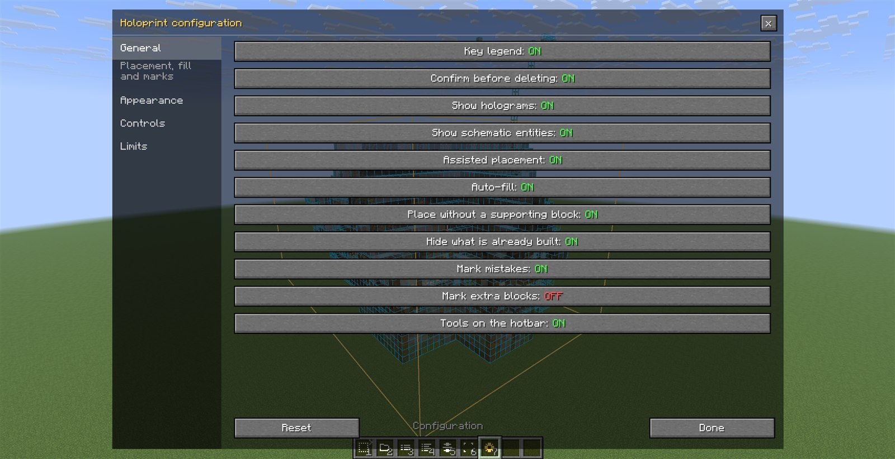
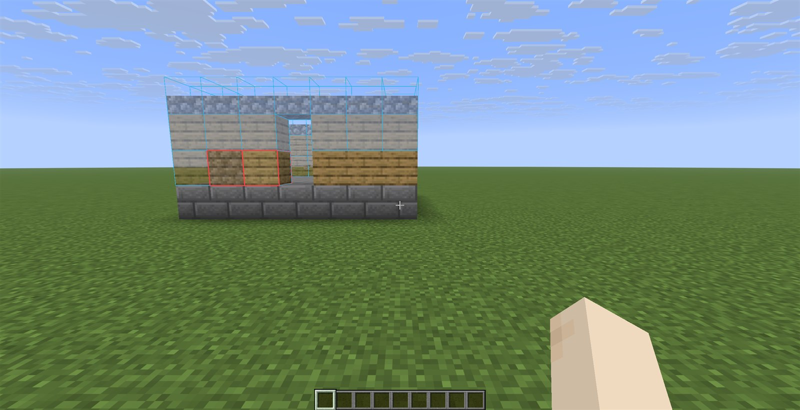

# Holoprint

A client-side Fabric mod for Minecraft 26.3 that turns schematics into holograms you can fly around, move, check and build from. Think Litematica, but simpler: a free camera, a hotbar full of tools, and nothing to configure before you start.

Holoprint is client-only. It does not need to be installed on the server.

## Features

- **Loads schematics.** `.litematic`, Sponge `.schem` and legacy `.schematic` files from the `schematics` folder. Litematica files from older Minecraft versions are updated on load.
- **Shows them as a hologram.** Translucent ghost blocks with a blue outline on every block (it can be turned off or recoloured in the settings). Big builds stay smooth because the models are kept on the GPU.
- **Free camera.** Press `M` and fly around your build without moving your character. Press `M` again to leave.
- **Move, rotate and mirror.** The hologram follows your pointer, a click pins it, and `R` / `Z` rotate and mirror it.
- **Checks what you have built.** Blocks that are missing show as ghosts; blocks that are wrong are outlined in red.
- **Assisted placement.** Aim at the hologram and place: the block goes in with the right state and orientation.
- **Layers.** Look at one layer at a time, and step up and down through the build.
- **Material list** for every placement.
- **Several placements at once.** Each one can be hidden, locked or removed on its own.
- **Selection, copy, paste, delete and save.** Select an area of the world, copy it, paste it as a new hologram, or save it as a schematic.
- **Build (needs cheats).** Build a whole placement in one go, or move a real area with `/clone`.

## Tools on the hotbar

In the free camera the hotbar becomes the editor's toolbar. Use the number keys or the mouse wheel to pick a tool, and the use click to activate it. Your own selected slot is never touched.

| Slot | Main page | Editing folder (slot 1) |
|---|---|---|
| 1 | Editing tools (shows the active mode) | Move |
| 2 | Load a schematic | Select |
| 3 | Placements | Copy |
| 4 | Material list | Delete |
| 5 | Layers | Build |
| 6 | Area editor | |
| 7 | Settings | |
| 9 | | Back |

While a tool is highlighted, the keys that go with it are shown above the hotbar, using the keys you have set in the game's controls. `Ctrl` + wheel (or `,` and `.`) changes the flying speed. The tools can be put back in the old place, a menu opened from the free camera, by turning off the hotbar tools in the settings.

## Layers

Show a single layer of a build, then step through it, to see exactly where every block goes.

## Windows

Everything that needs more than a click opens in a window, and closing it takes you back to the camera.

| | |
|---|---|
|  |  |
|  |  |

The area editor is for typing the two corners of an area by hand when you want an exact one.

## Checking a build

As you build, what already matches the hologram disappears and what is left stays as a ghost. A block that is there but is not the one the schematic asks for is outlined in red.

## Controls

All of them are normal key bindings, so you can change them in the game's controls screen.

| Key | Action |
|---|---|
| `M` | Open / close the free camera |
| `1`-`9`, wheel | Pick a tool on the hotbar |
| Click | Use the tool; with Move, pin or pick up the hologram |
| `R` / `Z` | Rotate / mirror |
| Arrow keys, `Page Up` / `Page Down` | Nudge the hologram one block |
| `N` | Change the editing mode |
| `B` | Build the placement you point at (needs cheats) |
| `J` | Material list |
| Numpad `+` / `-` / `*` | Layer up / down / all or one |
| `Ctrl` + `C` / `X` / `V` | Copy / cut / paste |
| `Backspace` | Cancel |

If you also have Litematica installed, some of its default keys (for example the numpad `-`) are used by both mods; change one of them in the controls screen.

## Install

1. Install [Fabric Loader](https://fabricmc.net/) and the Fabric API for Minecraft 26.3.
2. Put `holoprint-26.3.jar` in your `mods` folder.
3. Put your schematics in the `schematics` folder of the game and press `M` in a world.

## Build from source

On Windows run `gradlew.bat build` (`./gradlew build` elsewhere). The mod is left in `build/libs/holoprint-26.3.jar`.

## Status

Under development, not published yet. Controller support (Controlify) is planned.
